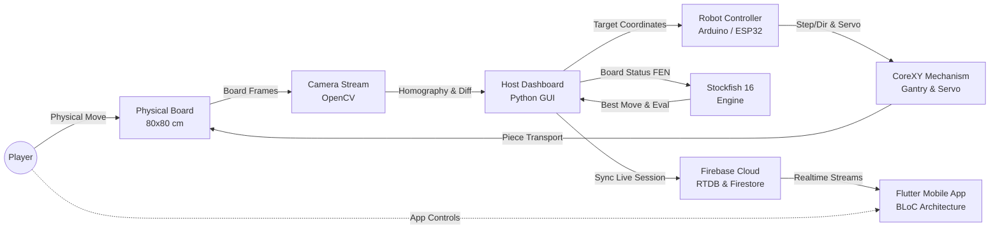

# The Ghost Chessmaster (ChessTracker)

[](https://github.com/hasan-sawaf/The-Ghost-Chessmaster/actions/workflows/ci.yml)
[](LICENSE)
[](https://www.python.org/)
[](https://flutter.dev/)

An automated chess training and competition system combining a physical **CoreXY robotic chessboard**, **OpenCV** overhead computer vision for move detection, the **Stockfish 16** AI engine for move evaluation & post-game analysis, **Firebase** (RTDB & Firestore) for cloud synchronization, and a **Flutter** mobile application (`GhostChessMaster`) for live match control, campaign training, and game review — all working together in real time.

---

## Graduation Project Team & Credits

**Faculty of Mechanical & Electrical Engineering (FMEE)**  
**Department of Computer Engineering & Automation — University of Damascus**  
**Academic Year:** 2025 – 2026

### Project Authors / الطلاب المعدّون
- **ألين سهيل تامر** — *Aline Suhail Tamer*
- **حسن محمد طريف الصواف** — *Hassan Mohammad Tareef Al-Sawaf*
- **علاء عادل جمعة** — *Alaa Adel Jumaa*
- **عبد الحكيم محمد عوض** — *Abdul Hakeem Mohammad Awad*

### Academic Supervisor / إشراف
- **د. هيام خدام** — *Dr. Hiam Khaddam*

---

## System Architecture



---

## Key Capabilities

### 1. Python Host Dashboard (`src/software/`)
- **Computer Vision Move Detection:** Overhead webcam with 4-corner perspective homography calibration (`board_calibration.json`) detects legal physical moves automatically.
- **Stockfish 16 Integration:** Adjustable AI strength (ELO presets & skill levels) plus full post-match PGN move classification (*Brilliant, Best, Excellent, Good, Book, Inaccuracy, Mistake, Blunder*) and centipawn-loss accuracy scoring.
- **CoreXY Motion & Serial Bridge:** Translates chess squares into physical coordinates, handles capture parking/knight pathing, and communicates over USB serial (`115200` baud).
- **Cloud Sync & QR Pairing:** Generates a board pairing QR code (`board_config.json`) and synchronizes live moves, clocks, and settings via Firebase RTDB & Firestore.

### 2. Flutter Mobile Application (`src/ghostchessmaster/`)
- **Remote Match Control:** Scan the host QR code to pair with a physical board, configure timers/ELO/play style, and start/pause/reset matches remotely.
- **Live Board Synchronization:** Watch physical moves update on your phone in real time.
- **Training Islands Campaign:** Play progressive themed challenges offline or online with integrated on-device Stockfish evaluation.
- **Match History & Deep Review:** Review past matches move-by-move with accuracy stats, evaluation graphs, and move quality badges.

### 3. Microcontroller Firmware (`src/firmware/mcu_core_xy/`)
- **CoreXY Kinematics (`kinematics.cpp`):** Drives dual NEMA 17 steppers (`AccelStepper`) with limit-switch homing and servo-actuated sub-board neodymium magnet lifting.
- **Game Clock & Hardware UI (`timers.cpp`):** Manages white/black chess timers, increment logic, physical control buttons, and a `16x2` I2C LCD (`0x27`).

---

## Credential & Firebase Setup Guide

> [!IMPORTANT]
> **Security Notice:** All active Firebase credentials in this repository are replaced with safe placeholders. The host dashboard and mobile app still start in offline/local mode out of the box, and you should insert your own Firebase project credentials to enable live cloud sync and authentication.

| Target Service | File Path | Instructions |
| :--- | :--- | :--- |
| **Python Firebase Key** | `src/software/infrastructure/persistence/config/serviceAccountKey.json` | Download your Firebase Service Account JSON key from *Firebase Console -> Project Settings -> Service Accounts*, and paste its contents into this file. *(Template: `serviceAccountKey.json.template`)* |
| **Python Board Config** | `src/software/infrastructure/persistence/config/board_config.json` | Set your `rtdb_url` endpoint (e.g. `"https://YOUR_PROJECT_ID-default-rtdb.firebaseio.com/BOARD_8AA5C5"`). *(Template: `board_config.json.template`)* |
| **Flutter Firebase Options** | `src/ghostchessmaster/lib/firebase_options.dart` | Replace dummy placeholders (`YOUR_*_API_KEY_HERE`) with your Firebase project API keys, or run `flutterfire configure` inside `src/ghostchessmaster/`. |
| **Android Firebase File** | `src/ghostchessmaster/android/app/google-services.json` | Download `google-services.json` from *Firebase Console -> Project Settings -> Android App*, and place it here. *(Template: `google-services.json.template`)* |

---

## Getting Started

### Prerequisites
- **Python 3.10+** (with `pip` and Tkinter)
- **Flutter SDK 3.x+** & **Dart 3.x+** (for mobile/desktop Flutter app)
- **Arduino IDE / PlatformIO** (optional, only for flashing `src/firmware/mcu_core_xy/`)
- **Hardware (optional for physical play):** Overhead USB webcam + CoreXY controller connected via USB serial COM port

### 1. Clone the Repository
```bash
git clone https://github.com/hasan-sawaf/The-Ghost-Chessmaster.git
cd The-Ghost-Chessmaster
```

### 2. Run the Python Host Dashboard
1. Create and activate a virtual environment:
   ```bash
   python -m venv .venv
   # Windows:
   .venv\Scripts\activate
   # Linux / macOS:
   source .venv/bin/activate
   ```
2. Install Python dependencies:
   ```bash
   pip install -r requirements.txt
   ```
3. Launch the host GUI application:
   ```bash
   python main.py
   ```
4. *(Optional)* Build a standalone Windows `.exe` using PyInstaller:
   ```cmd
   pip install -r requirements-build.txt
   rebuild.bat
   ```
5. *(Optional)* First-time camera calibration:
   - Click **CALIBRATE BOARD** in the host GUI and mark the 4 physical corners of the chessboard to compute the OpenCV homography grid.

> **Note:** The bundled Stockfish executable (`src/software/infrastructure/ai/stockfish-windows-x86-64-avx2.exe`) targets Windows x86-64. On Linux or macOS, install Stockfish for your platform and update `ENGINE_PATH` in `src/software/core/config.py`.

### 3. Run the Flutter Mobile App (`src/ghostchessmaster`)
```bash
cd src/ghostchessmaster
flutter pub get
flutter run
```
To build a release Android APK:
```bash
flutter build apk --release
```

### 4. Flash Microcontroller Firmware (`src/firmware/mcu_core_xy`)
See [src/firmware/README.md](src/firmware/README.md) for pin mappings, required Arduino libraries (`AccelStepper`, `Servo`, `LiquidCrystal_I2C`), and serial protocol details.

---

## Running Tests

### Python Unit & Engine Tests
```bash
python -m unittest discover -s tests -v
```

### Flutter Analyzer & Widget Tests
```bash
cd src/ghostchessmaster
flutter analyze --no-fatal-infos
flutter test
```

---

## Repository Structure

```text
The-Ghost-Chessmaster/
├── main.py                                   # Main Python host entrypoint
├── rebuild.bat                               # Windows PyInstaller standalone build script
├── requirements.txt                          # Python runtime dependencies
├── requirements-build.txt                    # Python build dependencies (PyInstaller)
├── LICENSE                                   # MIT License
├── README.md                                 # Project documentation
├── docs/                                     # Graduation thesis & presentation deck
│   ├── The_Ghost_Chessmaster_Thesis.pdf
│   ├── The_Ghost_Chessmaster_Thesis.docx
│   └── The_Ghost_Chessmaster_Presentation.pptx
├── tests/                                    # Python unit & Stockfish integration tests
│   └── test_domain_rules.py
└── src/
    ├── firmware/                             # Microcontroller C++ firmware & wiring guide
    │   ├── README.md
    │   └── mcu_core_xy/                      # Arduino CoreXY stepper, servo & LCD timer
    ├── software/                             # Python host application (Clean Architecture)
    │   ├── main.py                           # Process & UTF-8 stream bootstrap
    │   ├── application/                      # Use cases & ports (match analyzer)
    │   ├── core/                             # Configuration, constants & logging
    │   ├── domain/                           # Chess rules, CPL scoring & move classification
    │   ├── infrastructure/                   # OpenCV vision, Stockfish 16, Firebase & Serial
    │   └── presentation/                     # Tkinter GUI views, components & state
    └── ghostchessmaster/                     # Flutter mobile application (BLoC + DI)
        ├── lib/                              # Dart source code
        ├── assets/                           # Piece themes, icons & sound effects
        ├── test/                             # Flutter widget & chess logic tests
        ├── android/                          # Android build configuration
        └── pubspec.yaml                      # Flutter package manifest
```

---

## Hardware & Firmware Specifications

| Component | Specification |
| :--- | :--- |
| **Microcontroller** | Arduino Mega / ESP32 (Serial @ `115200` baud) |
| **Motors** | 2x NEMA 17 Stepper Motors (CoreXY kinematics, `80.0` steps/mm) |
| **Motor Drivers** | 2x DRV8825 drivers with 1/16 microstepping |
| **Magnet Lifter** | Servo motor raising sub-board neodymium magnet |
| **Sensors & Display** | 2x Homing Limit Switches + `16x2` I2C LCD Display (`0x27`) + 3x Physical Buttons |
| **Board Area** | 80x80 cm wooden chassis, 48x48 cm active grid (6 cm per square) |

---

## License

This project is licensed under the [MIT License](LICENSE).
